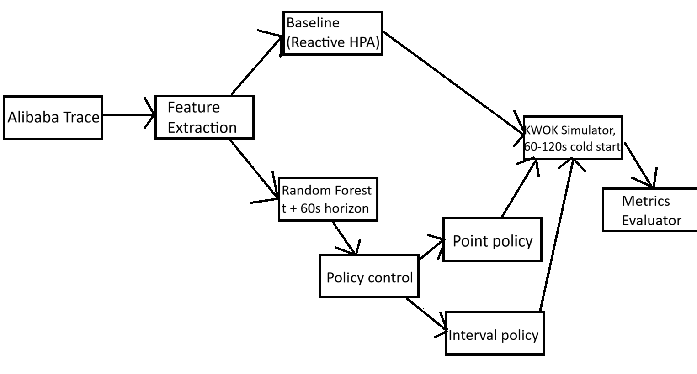

# Predictive Autoscaling for Resource Usage (CPU and memory)

**Author:** Shi Cheng Huang  
**Course:** CSC 59866  
**Selected project and option:** Build or improve a distributed system tool (option 1) - a predictive autoscaling for Kubernetes on resource usage to improve existing HPA before threshold is breached.   
**Current assignment:** 3   
**Friday commit deadline:** November 22 at 11:59 p.m. New York time  
**Monday presentation:** November 23 at 6:30 p.m. New York time  
**Last updated:** 11/21/26  
**Document status:** ready for review

## Progress note

<!-- Write 100–150 words: changes, learning, main open issue, feedback addressed,
and next step. Link evidence when available. Update at each Friday deliverable. -->
This week, I refined Sections 1 and 2 based on instructor feedback, adding literature citations, a four-milestone Semester II scope with a $t + 60\text{s}$ forecast horizon, an 80% target utilization threshold, and metrics tracking shortfall magnitude, duration, and resource cost. Section 2 now details the chronological correctness rule ($t_{\text{feature}} < t$). In Section 3, I revised by adding the proposed approaches (point and interval policies) into comparisons and against the requirement. In addition, I justified the Random Forest selection. Section 4 maps out the system architecture and data flow from Alibaba traces through the Feature Extractor and Policy Controller into the KWOK simulator. Section 5 defines component responsibilities and the predict_resource_demand critical operation. Finally, Section 9 was updated with our lightweight MVP and feasibility results.   
  Next step: Data algorithms and failure behavior. (11/21/26)

## Contents

- [1 Problem research and scope](#1-problem-research-and-scope)
- [2 Requirements and system specification](#2-requirements-and-system-specification)
- [3 Alternatives and selected solution](#3-alternatives-and-selected-solution)
- [4 Architectural design](#4-architectural-design)
- [5 Component design and interfaces](#5-component-design-and-interfaces)
- [6 Data structure design](#6-data-structure-design)
- [7 Algorithm design and execution](#7-algorithm-design-and-execution)
- [8 Failures and security](#8-failures-and-security)
- [9 Implementation and feasibility](#9-implementation-and-feasibility)
- [10 Testing and verification](#10-testing-and-verification)
- [11 Operation maintenance and future work](#11-operation-maintenance-and-future-work)
- [12 Revision history and references](#12-revision-history-and-references)

## 1 Problem research and scope

<!-- Assignment 1. Describe a person, task, difficulty, and consequence using
a concrete scenario. Label assumptions. Distinguish a larger research project's
aims from your own contribution where relevant. -->

**Problem and affected people:** The problem that I am investigating is the reactive autoscaling for resource usage, which means giving computer resources including CPU (central processing unit that processes instructions), memory (which stores active data) only after a threshold is crossed while working on a workload. As a reactive method, the system watches resource usage and only adds resources when CPU or memory crosses a threshold. This is inefficient when many different workloads must be managed, which leads to consequences such as slowing down the process and performance degradation within distributed computing systems.  
### The affected people are:
| Stakeholders | Type | Responsibility/Need | Source link |
|:---|:---|:---|:---|
| Cloud operators, platform engineers, and the organization | Internal | Responsible for the cluster and for allocating resources to avoid SLO violations | https://trepo.tuni.fi/handle/10024/238698#1 |
| Users and clients | External | Access the service and need fast responses without degradation | https://www.jisem-journal.com/index.php/journal/article/view/13473/6334 |

SLO is a target for service performance and a violation occurs when performance fails to meet that target within a given time window.

This problem matters because it costs money and hurts users' experience when workloads receive the wrong amount of resources. The problem occurs under conditions where resource demand changes so quickly that the system is unable to react, especially with unpredictable workloads. When demand for a workload is steady, the reactive method can function properly, but this is not always the case when demand is bursty.

**Current workflow:** To understand why this problem matters, consider a concrete example. A web service normally receives 100 requests per second. At a certain time, the traffic to the web service jumps to 500 requests per second within 30 seconds. The Horizontal Pod Autoscaler (HPA), a Kubernetes (a system for automating deployment and scaling of containerized applications) component that automatically adds or removes application instances when resource usage rises above or falls below a target threshold, checks metrics every 15–30 seconds [1]. Thirty seconds later, it detects CPU above 80% [3], and 15 seconds after that, it starts scaling [1]. Each new instance takes 60–120 seconds to start [1], after which new capacity is available. During the waiting period, existing instances are overloaded and lack resources. Response times increase, and some requests time out.    
- 100-to-500 requests/s burst is the illustrative setting   

     
Figure 1. The HPA control loop checks metrics every 15–30 seconds and adds replicas when the threshold is breached.

### Conditions and difficulty:
- Under normal conditions, reactive autoscaling works when resources are sufficient. 
- It fails when resources are insufficient (under-provisioning), causing slowdowns and timeouts.
- It wastes money when resources are excessive (over-provisioning), even though the service itself continues to function. 

Therefore, the right number of resources is required for service-level objective. 

**Evidence:** 
- Reactive autoscaling is structurally lagging, "the metric-scrape interval (15-30 s), the HPA reconciliation cycle (15-45 s), and pod cold-start time (60-120 s) execute sequentially". This leads to a three-to-five-minute timing period spent waiting to scale resources after the threshold is breached. During this window, it leads to tail-latency degradation (the slowest performance) and service-level objective (SLO) violations. [Documented] This claim is documented by the thesis of Tran, Duy Anh. [1]
- Conventional autoscaling, which is a reactive method, scales workloads based on the resource utilization of CPU and memory, which can lead to a failure to anticipate the burst demand of these workloads. This means that with the reactive method, the resources used for certain workloads cannot handle the burst demand for immediate changes in resources to achieve better performance. [Documented] This claim is documented by the abstract by Karthik Chakravarthy Cheekuri. [2]
- With sudden load spikes, Horizontal Pod Autoscaler will trigger the threshold and wait for the new resource, which can cause cold starts (the delay before a new instance is ready to serve requests), temporary under-provisioning, and frequent SLO violations. The baseline HPA uses "current CPU utilization with different target values such as 80 percent," which is the threshold used in the concrete example in Section 1.[Documented] This claim is documented by the poster by Hyunsu Jeong and others. [3]   
- AROF, a peer-reviewed journal article, states that "Traditional Kubernetes autoscaling struggles with dynamic workloads, causing SLA violations and inefficiency". This shows the reactive problem of autoscaling exists. This article measures SLA (stands for Service Level Agreement, a contractual commitment to a customer) violations, not SLO violations, but the underlying failure is the same with unable to provide service to the user/client. [Documented] This claim is documented by Patel and Makwana [5]

**Six-week contribution:** By the end of six weeks, I will demonstrate a prototype that runs on a laptop using KWOK as the Kubernetes simulator. The prototype targets one specific workload: a single CPU-demand series for one microservice from the Alibaba 2021 trace. The forecast horizon is one sampling interval ahead. The prototype predicts CPU demand, and makes a scaling decision to add replicas in the stated capacity model (as 80% target utilization threshold [3]). The success thresholds are that the pipeline produces a forecast and a scaling decision for each interval, and that the forecast can be compared against reactive HPA on the same demand series. 

**Semester II scope:** In semester II, I will add to the complete project in four sequential milestones:
- **Trace inspection:** select one CPU-demand series from Alibaba 2021 trace, which contains bursty demand, and split it into training and testing segments.
- **Forecasting:** train a Random Forest model on the training segment and generate both point and interval forecasts one sampling interval ahead.
- **Allocation simulation:** apply a stated capacity and startup-delay (as 80% target utilization threshold [3] and 60-120 seconds cold-start delay [1]) to convert the forecast into a scaling decision.
- **Policy comparison:** compare the forecast policy (point and interval) with reactive HPA on the same demand. 
These four milestones will then be repeated on the memory demand series for the same microservice.  

The project report two evaluation measurments:
- **Resource Shortfall (Magnitude and Duration):**
    - **Capacity Shortfall (Magnitude):** The total volume of missing resource units (CPU/memory) when actual demand exceeds active provisioned capacity during spike.
    - **Shortfall Duration (Time below modeled required capacity):** The cumulative duration which the actual demand exceeds active provisioned capacity. Since this project is trace-replay simulation tracking resource supply and demand rather than simulating new request-level queuing latency, shortfall duration is reported as a proxy for SLO violations.  
- **Allocated resource-time:** The total compute capacity provisioned used, subject to a proposed limit of no more than 10% additional resource cost compare with the point-prediction  interval.  

**Expected operator improvement:** Compared with reactive HPA, an operator using the proactive policy should observe substantially less time below modeled required capacity (fewer proxy SLO violations) during the sudden spikes, while within the 10% resource-time limit.


**Exclusions:** I will not build a production-ready system, modify the Kubernetes control plane, address GPU scheduling, train deep learning models, or consider I/O.

<!-- Add an actual image using a relative path, for example:


Figure 1. Explain what the workflow shows and why it matters.
Do not leave references to nonexistent images. -->

## 2 Requirements and system specification

<!-- Assignment 2. Explain required behavior before implementation methods.
Start with 3–5 functions, a correctness rule, and a quality target.
Complete design and test references during Assignments 2 and 3. -->

| ID | Required behavior and conditions | Acceptance check | Design and test reference |
|---|---|---|---|
| F1 | Predict future CPU and memory demand to scale resources before the 80% utilization threshold [3] is crossed, using a forecast horizon of t + 60 seconds. | Given a trace where demand rises above the 80% threshold, verify that the system outputs a forecast for t + 60 seconds and initiates scaling before breach. | Test T1 (normal operation) |
| F2 | Support two decision policies: scale on the point prediction (single number), and scale on the prediction interval (the upper bound of the range). | Both policies will be run on the same trace and produce scaling decisions that can be compared. | Test T2 (policy comparison) |
| F3 | Measure for each policy: capacity shortfall magnitude (total numerical volume of missing resource units), shortfall duration (cumulative time steps below required capacity, reported as proxy SLO violations), and allocated resource-time cost. | The output reports total missing resource volume (demand - capacity), cumulative violating time steps, and total resource-seconds (number of replica * seconds used) for both policies on the same workload. | Test T3 (measurement) |
| F4 | Reject stale metric data that is older than 30 seconds ($\Delta t < 30.0\text{s}$). | A sample with a timestamp older than 30 seconds from current time t is explicitly rejected, and the system waits for fresh data. | Test T4 (stale data) |
| C1 | Use only data from before the prediction time t to prevent data leakage ($t_{\text{feature}} < t$). | Assert that training uses on a strict chronological split (first 70% of trace) ane test inference accesses no future timestamps. Test T5 injects a future-dated sample requires immediate rejection. | Test T5 (correctness rule) |
| Q1 | Reduce both capacity shortfall magnitude and shortfall duration (proxy SLO violations) compared to reactive HPA while keeping interval policy within 10% of the point policy. | **Definition:** A proxy SLO violation is any time step where actual demand exceeds active allocated capacity. **Target:** Achieve at least 20% fewer violating time steps (proxy SLO violations) than the reactive baseline, with no more than 10% additional resource-seconds. Workload: Alibaba 2021 trace | Compare across the reactive HPA, point policy, and interval policy. |

**Inputs and outputs:**
- Ordinary example: At time t, the system receives fresh CPU and memory usage samples (within 30 seconds of t). It predicts demand for t + 60 seconds using only samples that is $\le t$. If predicted demand exceeds the 80% utilization thresholds, it outputs a decision to scale up relicas. 
- Unsuccessful example: The system receives a metric sample that is older than 30 seconds or contains a future timestamp ($t_{\text{feature}} > t$), it immediately reject this sample and waits for fresh data rather than making decision on stale or leaked information.  

**Assumptions:**
| Assumptions | How to check it |
|---|---|
| Kubernetes, HPA, and metrics-server are running | Check that metrics-server and HPA are active in the cluster|
| Prediction will reduce shortfall magnitude and shortfall duration (proxy SLO violations) compared with reactive HPA | Compare deficit volumes and shortfall durations on the same trace|
| The Alibaba 2021 trace represents bursty workloads | Check the trace's workload description |
| The simulator reproduces the 60-120 second pod cold-start time [1] to act like real Kubernetes | Run one test scaling event and time it |

**Constraints:** 
- Time: One student with two semesters to work on. 
- Tools: Python, scikit-learn, Random Forest model, KWOK. No production cluster (real).
- Data: Alibaba 2021 trace. No live cluster data.
- Resources: The simulator runs on a laptop, which is not a cloud platform.

## 3 Alternatives and selected solution

<!-- Draft in Assignment 2; complete in Assignment 3. Compare at least two
approaches under the same requirements, including a simple baseline. -->

| Approach and source| Useful behavior | Limitation | Evidence or assumption |
|---|---|---|---|
| Simple baseline: Reactive HPA [1] | Built into Kubernetes, works for steady workloads | Scales only after the 80% threshold is crossed, resulting in a large capacity shortfall magnitude and 3-to-5 minutes shortfall duration (proxy SLO violation) | https://trepo.tuni.fi/handle/10024/238698#1 |
| Proposed RF Point Policy | Anticipates demand 60 seconds ahead using single-value point forecast to trigger proactive scaling | May still incure minor shortfall magnitude during extreme variance spikes | Evaluated locally on Alibaba 2021 trace | 
| Proposed RF Interval Policy | Uses the upper prediction interval as a safety buffer to cover the 60-120 seconds pod cold-start lag. | Higher allocated resource-time cost, bounded by the proposed $\le 10%$ extra resource-second ceiling | Evaluated locally on Alibaba 2021 trace |
| Kairos operator [4] | Predicts future CPU and memory usage and adjusts resource allocation, using AI, before demand arrives. Allows multiple scaling modes, avoids conflicts with other Kubernetes autoscaling tools. | Needs an external AI service; relies on historical patterns; does not report shortfall magnitude or duration. | https://operatorhub.io/operator/kairos-operator |
| AROF (Adaptive Resource Optimization Framework) [5] | Combines hybrid classification (clustering and tagging) and multi-horizon LSTM forecasting with cost optimization. It uses multi-horizon forecasting, which produces predictions over multiple future time horizons. | Complex model; LSTM increases training cost; long-term predictions are uncertain. Reports SLA violations rather than resource-level capacity shortfall magnitude and duration. | https://www.tandfonline.com/doi/full/10.1080/17445760.2025.2605532?scroll=top&needAccess=true |

LSTM stands for Long Short-Term Memory, a type of neural network that learns patterns in sequences over time.   
SLA stands for Service Level Agreement, a contractual commitment to a customer.

### Comparison Table
| Approach | F1 | F2 | F3 | F4 | Q1 |
|---|---|---|---|---|---|
| Simple baseline: Reactive HPA | No | No | Partial (provides raw metrics, not shortfall magnitude, duration, or cost) | No | Reference baseline (0% reduction) |
| Proposed RF Point Policy | Yes | Yes (point value) | Yes (shortfall magnitude, proxy SLO violation, and cost) | Yes | Target: > 0% reduction in both shortfall magnitude and duration |
| Proposed RF Interval Policy | Yes | Yes (interval bound) | Yes (shortfall magnitude, proxy SLO violation, and cost) | Yes | Target: $\ge 20\%$ reduction in both shortfall magnitude and duration; within $\le 10\%$ extra resoruce cost |
| Kairos operator | Yes | No (focuses on multiple modes) | No (reports cost estimation without shortfall metrics) | Not documented | Not measured |
| AROF (Adaptive Resource Optimization Framework) | Yes | No (focuses on cost optimization) | No (reports SLA, not proxy SLO) | Not documented | Not measured |

**Requirement key:**
- **F1:** Forecast before threshold breach (t + 60 seconds horizon)
- **F2:** Two decision policies (point vs. interval)
- **F3:** Measure capacity shortfall magnitude, shortfall duration and cost
- **F4:** Reject stale data ($\ge 30\text{s}$ old)
- **Q1:** Reduce capacity shortfall magnitude, shortfall duration compared with reactive HPA

**Choice and reason:** I choose the Random Forest point and interval policies because they meet the requirements and fit my project constraint better than reactive HPA, Kairos, and AROF.
- Meet all requirements: Random Forest can forecast demand 60 seconds ahead (F1), provide both single-point and interval ranges (F2), track shortfall and resource costs (F3), and to filter out stale data (F4). The training data set can be used on chronological split to prevent data leakage for Random Forest model (C1). The interval policy acts a safety buffer to hit Q1 goal, reducing proxy SLO violations by at least 20% while keeping extra resource costs under 10%.
- Fit the constraints: Unlike AROF's complex neural network or Kairo's dependence on cloud AI service, Random Forest trains quickly on a local, standard laptop and work with KWOK simulator without needing a real production cloud platform.

### Decision 1

**Context and requirement:** To have a machine learning model that can forecast CPU and memory demand 60 seconds ahead (F1) and provide both point and interval predictions (F2) while running locally on a standard laptop.    
**Options:** Kairos operator (cloud AI), AROF (LSTM neural network), and Random Forest regressor.   
**Decision and reason:** I select Random Forest regressor. It effectively captures non-linear Alibaba workload patterns without require heavy cloud infrastructure or complex neural network tuning, while supporting quantile regression for interval predictions.     
**Consequences:**
- Benefits: Low resource needed, robust to outliers, and straightforward interval estimation using tree quantiles.
- Costs/Limitations: Tree-based models cannot extrapolate trends outside the numerical range seen during training.      

**Status and revisit condition:** Accepted, it would change if the trace required deep sequential memory like LSTM.  

### Decision 2

**Context and requirement:** To measure if proactive scaling works (F3, Q1) in a local trace simulation where live request latency isn't available.     
**Options:** Live P95 latency (duration), simple binary failure counts (SLO violations count), or resource-level metrics (shortfall magnitude, shortfall duration/proxy SLO violations, and resource-time cost).    
**Decision and reason:** I select resource-level metrics because simulation track supply and demand. Shortfall magnitude measures deficit size, duration measures proxy SLO violations, and cost limits over-provisioned.     
**Consequences:**
- Benefits: Measure user-facing reliability (duration) and capacity shortfall (magnitude) without over-provisioned.
- Costs/Limitations: This is simulated approximations rather than live production network of server.    

**Status and revisit condition:** Proposed, it would change when move to a live cluster environment.

## 4 Architectural design

<!-- Assignment 3. Show context and the main running programs and stores.
Embed a diagram from assets and retain editable source. Mermaid is optional. -->

**Boundary and outside participants:**
- System boundary: The architecture models a local autoscaling simulation pipeline designed to evaluate and compare reactive baseline scaling against proactive approach using real-world workload trace. Local Python execution environment running trace ingestion, feature extraction, the Random Forest inference engine, the policy controller, and the local KWOK cluster simulation loop.
- Outside participants: Remote Alibaba (open source software) hosting the 2021 microservice trace logs.

**Main parts and messages:**    
     
Figure 2. The proposed architectural design from data extraction into compared prediciton policies with baseline (reactive) and test them in KWOK to report metrics

- Alibaba Trace: Raw historical logs stored in remote open source software storage.
    - Arrow from Alibaba Trace to Feature Extraction: raw resource used records (CPU and memory) into the processing pipeline.
- Feature Extraction: Sliding window processor that extracts lag features and enforce strict chronological ordering ($t_{\text{feature}} < t$). Maintains temporary in-memory buffers during execution.
    - Arrow from Feature Extraction to Baseline: have current utilization metrics straight to the reactive path.
    - Arrow from Feature Extraction to Random Forest: Reject stale data (older than 30 seconds), otherwise feeds historical feature vectors into the ML model. 
- Baseline (reactive HPA): Standard threshold-based autoscaling to react to the resource usage when crossed threshold.
    - Arrow from Baseline to KWOK Simulator: Have the current metrics of resource usage into the simulated cluster environment.
- Random Forest (t + 60s horizon): Regressor model trained to forecast future resource demand 60 seconds ahead. Stores trained model weights in memory.
    - Arrow from Random Forest to Policy control: Passes point prediction and confidence interval to the policy decision layer.
- Policy control: Decision engine that evaluate forecasts and routes scaling actions to either the Point policy or Interval policy.
    - Arrows from Policy control to Point policy & Interval policy: Routes the forecast data into two alternative proactive scaling evaluation approaches.
- Point policy: Evaluates the deterministic single-point prediction to execute standard target replica adjustments.
- Interval policy: Evaluates prediction interval (upper bound) to account for model uncertainty and buffer against sudden, unpredictable load spikes.
    - Arrows from Point policy & Interval policy to KWOK Simulator: Transmitted the resulting scaling decisions to the cluster simulations.
- KWOK Simulator (60-120s cold start): Local Kubernetes-in-Docker simulation on pod provisioning delays and active cluster capacity. Maintains simulated cluster pod inventory in runtime memory.
    - Arrow from KWOK Simulator to Metrics Evaluator: Outputs resulting pod states, resource allocations, and operational timelines.
- Metrics Evaluator: Evaluation on the capacity shortfall magnitude and duration (proxy SLO violations), and resource utilization with cost across the approaches.  

**Where parts run:**
- Shared Execution Environment: All components - including trace ingestion, feature extraction, Random Forest inference, policy controllers, and the KWOK simulation loop - execute locally within a unified Python runtime environment (or Google colab notebook).
- Dependencies: Relies on local CPU threads and memory, along with Python computing libraries (scikit-learn, pandas, numpy) and the KWOK binary/control loop.

**What I build reuse or simulate:** I simulate on the Kubernetes container cluster environment using KWOK and model real-world pod cold-start provision delays (60-120s) to evaluate and compare reactive and proactive autoscaling policies using Alibaba 2021 trace data. 

## 5 Component design and interfaces

<!-- Assignment 3. A component can be a function or module in one program. -->

| Component | Responsibility | Input | Output or state change |
|---|---|---|---|
| Feature Extractor | Parse raw trace logs, compute lag features, and enforces the data freshness guard ($\Delta t < 30\text{s}$). | Raw CSV trace files (pd.DataFrame) and current timestamp (float) | Validated feature vector array (np.ndarray); updates in-memory sliding window buffer state. |
| Predictive Model (Random Forest) | Processes lag features to forecast resource demand 60 seconds ahead (t + 60s). | Feature vector array (np.ndarray) and horizon (int) | Point forecast and upper-bound interval (Tuple[float, float]) |
| Policy Controller | Evaluates metrics or model forecasts to compute target pod replica counts across reactive and proactive modes. | Demand metrics (float), current replica (int), mode (str) | Target replica count (int); updates active replica state. |
| KWOK Simulator | Models Kubernetes cluster capacity and pod cold-start provisioned delays (60-120s). | Target replicas (int) and timestamp (int). | Updated cluster inventory state (ClusterState); output pod status timelines. |
| Metrics Evaluator | Evaluates capacity shortfall magnitude and duration (proxy SLO violation), and resource utilization cost | Simulation history logs ( List[ClusterState] ) | Summary evaluation dictionary ( Dict[str, float] ); writes performance logs to disk.|

**Critical operation:** predict_resource_demand - Executes inference using the RandomForestRegressor to generate future resource demand estimates ($\hat{y}_{t+60}$) for proactive autoscaling, which meet the system's requirement on the 60-second forecast prediction (F1).

**Input:** 
- **features:** 2D NumPy array (np.ndarray), representing historical sliding-window lag features (CPU/memory usage values).
    - Allowed values: Non-NaN numerical floats sampled prior to time t.
    - Caller identity: PolicyController (or the main simulation loop).
    - Example: np.array([[1, 2, 3], [4, 5, 6]])
- **horizon:** Integer (int), representing prediction time offset.
    - Allowed value: Fixed at 60 seconds.
    - Caller identity: Passed along by the PolicyController, or the main simulation loop when it invokes the predict_resource_demand function.
    - Example: 60   

**Output:** 
- Fields & meanings: Return a tuple containing point_forecast (expected resource utilization) and upper_bound_forecast (upper confidence interval to prevent under-provisioning).
- Example: (0.58, 0.65) 

**State Change:** Stateless inference operation. State remains read-only, which cannot modify the state. 

**Errors:** 
- Condition 1 (Stale data): Handled at the boundary by the preceding FeatureExtractor checks the data timestamp against the 30-second freshness threshold ($\Delta t < 30.0\text{s}$) and raises a StaleMetricException if outdated.
    - Caller action: The main simulation loop catches StaleMetricException, halts the proactive path and defaults to the reactive HPA baseline for that time. 
- Condition 2 (Dimension mismatch): If the input features array shape does not match the dimensions required by the trained RandomForestRegressor, a ValueError is raised during execution.
    - Caller action: Catch ValueError, log the features mismatch, and safely fall back to the reactive baseline for the current simulation.

**Successful example:** 
- Call: predict_resource_demand(features=np.array([[0.40, 0.42, 0.45]]), horizon=60)
- Result: Returns (0.50, 0.57) successfully within ~3.94 ms.
**Unsuccessful example:**
- Call: Input array has an incorrect column dimension.
- Result: Raises ValueError, triggering the simulation fallback handler to baseline reactive HPA.

**Repeated or overlapping calls:** Thread-safe stateless execution, without modifying the state. Multiple calls with the same input will safely get identical, deterministic result without race condition.

## 6 Data structure design
Work to come; they are not due yet.

<!-- Assignment 4. Explain information and meaning, not only storage syntax. -->

| Record or structure | Fields and example values | Relationships and rules | Persistence |
|---|---|---|---|
| Replace | Replace | Replace | What survives restart? |

**Ownership:** Identify the authoritative place for important facts.

**Invalid combinations:** Explain how they are prevented or detected.

**Retention and deletion:** Explain how long data is needed and what deletion changes.

## 7 Algorithm design and execution
Work to come; they are not due yet.

<!-- Assignment 4. Replace this block with your pseudocode. Explain any step
that hides a guarantee, such as a protected write. -->

```text
ALGORITHM NAME(inputs)
    replace with input checks
    replace with decisions and state changes
    replace with output and error behavior
```

**Normal sequence:** Numbered steps or an explained sequence diagram.

**Interrupted sequence:** Failure point, surviving state, and recovery.

**Overlapping activity:** A conflicting execution and the mechanism that handles it.

**Resource estimate:** A small justified estimate if it affects the choice.

## 8 Failures and security
Work to come; they are not due yet.

<!-- Assignment 4. Include three adverse scenarios and two misuse cases. -->

| Scenario | State that may survive | Expected behavior | Planned check |
|---|---|---|---|
| Replace | Replace | Replace | Replace |

**Selected adverse case for the prototype:** Name the case and why it matters.

**Excluded conditions and consequences:** Replace.

| Possible misuse and affected asset | Response | Remaining limitation and check |
|---|---|---|
| Replace | Replace | Replace |

## 9 Implementation and feasibility

<!-- Begin the feasibility experiment and path in Assignment 3; refine in Assignment 4;
report implementation status in Assignments 5–6. -->

**Minimal path:** 
- Data ingestion: Load a 1-hour slice of the Alibaba 2021 microservice trace logs. 
- Feature extraction: Implement the sliding-window lag feature generator while enforcing chronological order ($t_{\text{feature}} < t$) from C1, and the 30-second freshness validation guard  ($\Delta t < 30.0\text{s}$) from Q4. 
- Baseline and Model setup: Implement the reactive HPA baseline and compare with trained a lightweight local RandomForestRegressor. 
- Simulation loop: Run a short execution tick loop to test metric reported and policy switched.

**Feasibility experiment:**
- Question: Can a local Random Forest model run inference in under 10ms using historical trace data?
- Procedure: 
    - Extract 100 historical CPU usage rows from the trace data
    - Generate a chronological lag feature (lag_1) 
    - Trained a RandomForestRegressor locally using Python
    - Have single-sample inference latency using time.time()
- Evidence: Average inference latency: ~3.94 ms per call. Memory used to run the code: < 0.1 MB. In addition, no error raised up during the execution.
- Finding: Local Random Forest model is lightweight and fast, easily clearing real-time simulation, without needing external to execute the code. 
- Resulting design decision: Proceed with local in-memory training and inference using standard Python library (scikit-learn, pandas, numpy) within the unified simulation runtime.

**Current implementation:** Distinguish implemented, reused, simulated, blocked, and deferred.

**Run instructions and CI:** Link README.md and the recorded check.

## 10 Testing and verification
Work to come; they are not due yet.

<!-- Plan in Assignment 4; add observations in Assignments 5–6. Expected outcomes
are not results. Link raw evidence. -->

| Test and requirement | Setup and procedure | Expected result | Status and evidence |
|---|---|---|---|
| T1 normal operation | Replace | Replace | Planned until run |
| T2 correctness rule | Replace | Replace | Planned until run |
| T3 adverse scenario | Replace | Replace | Planned until run |

**Baseline and comparison question:** Replace.

**Workload and environment:** Inputs, counts, timing, overlap, versions, machine, and reset.

**Measurements:** Units and populations, including unsuccessful operations.

**Actual results:** Explain what happened and what the evidence supports.

**Limits and next test:** State remaining uncertainty.

## 11 Operation maintenance and future work
Work to come; they are not due yet.

<!-- Draft in Assignment 4; add operating instructions in Assignment 5;
complete in Assignment 6. -->

**Startup and diagnosis:** How to run the system and recognize a problem.

**Recovery:** Action, preserved state, and verification of recovery.

**One future change:** Effects on components, interfaces, data, and tests.

**Update and rollback:** How to change versions and recover a working configuration.

**Responsible design:** Connect people, data, access, reuse, and resource use to choices.

| Risk | Early sign | Response or fallback |
|---|---|---|
| Replace | Replace | Replace |

| Semester II milestone | Dependency | Completion evidence | Essential or optional |
|---|---|---|---|
| Replace | Replace | Replace | Replace |

## 12 Revision history and references

| Revision date | Change to my design | Reason and evidence |
|---|---|---|
| 11/13/2026 | Add more evidences to show the reactive problem exists in the autoscaling for resource usage (in section 1) | See others have multiple evidences provided |
| 11/18/2026 | Add in-text citations, defined the capacity and start-up delay parameter within the design, updated measurements to include capacity shortfall magnitude, shortfall duration (proxy SLO violations) and allocated resource-time cost, and tie the open question to the 3-to-5 minutes scaling lag | Revisions based on instructor feedback from Assignment 1. | 
| 11/20/2026 | Revise section 2 with clarified the correctness rule (using a chronlogical split on trace for acceptance check); updated functional requirements (adding a forecast horizon of t + 60s with an 80% target threshold, defining capacity shortfall magnitude, duration, and cost metrics for acceptance checks, and setting the stale data threshold to 30 seconds for rejection); updated quality constraints (adding the resource-time cost limit of within 10% for the interval policy, and targeting at least a 20% reduction in shortfall duration compared to the reactive baseline); revised the successful and unsucessful examples to align with F1, F3, and F4; integrated KWOK as the Kubernetes simulator within constraints. Revise section 3 with added the proposed policy approaches (point and interval predictions) detailing useful behavior and limitation; added them to the requirement comparison table; updated requirement keys to match the current design. | Revisions based on instructor feedback from Assignment 2. |

| Open question | Why it matters | Next action |
|---|---|---|
| Will the prediction interval add enough buffer to cover the 3-to-5 minutes scaling lag (from traffic spike to ready pods [1]) and reduce both capacity shortfall magnitude and shortfall duration (proxy SLO violations) without exceeding the 10% allocated resource-time cost limit? | If the buffer is too small, spikes still fail with scaling lag; if it is too large, it wastes money. This decides whether we keep the interval policy | Run the KWOK simulation on Alibaba 2021 trace using the full scaling lag model, then compare shortfall time and resource cost across the point policy, interval policy, and HPA. |

**Assistance and reuse:** Attribute sources, code, data, diagrams, and assistance under course policy.

### References

<!-- Use descriptive links with author/organization, title, date/version, and
the claim supported. Also cite sources near relevant explanations. -->
[1] Tran, Duy Anh. "Predictive autoscaling for kubernetes using machine learning workload forecasting", Tampere University, June 2026, https://trepo.tuni.fi/handle/10024/238698#1  
[2] Karthik Chakravarthy Cheekuri. "SLO-First Autoscaling for Multi-Tenant Microservices: A Control-Theoretic Approach to P95/P99 Latency", Journal of Information Systems Engineering and Management, Oct 2025, https://www.jisem-journal.com/index.php/journal/article/view/13473/6334  
[3] Jeong et al. "SLO-Aware and Cost-Efficient Predictive Autoscaling for Kubernetes Microservices", Jeju National University, 2026, https://www.sc-asia.org/2026/data/poster/post240.pdf#1#1   
[4] Kairos Operator. OperatorHub, July 2026, https://operatorhub.io/operator/kairos-operator   
[5] Patel, Ravi, and Ashwin Makwana. "AROF: adaptive resource optimization framework for Kubernetes cluster using workload forecasting", International Journal of Parallel, Emergent and Distributed Systems, 2025, https://www.tandfonline.com/doi/full/10.1080/17445760.2025.2605532

### Supporting media and evidence

<!-- Link actual images, editable diagram files, logs, data, and optional video.
Explain each item's purpose. Avoid missing files and private-only paths. -->
- Figure 1 (Section 1): workflow diagram of the HPA control loop. The image is stored at `assets/workflow.png` and shows how HPA checks metrics every 15–30 seconds, detects a threshold breach, and adds replicas that take 60–120 seconds to start. This illustrates the three-to-five-minute lag that the project addresses.
- Figure 2 (Section 4): architectural design as a diagram with how main components connected using arrow. The image is storede at 'assets/architecture.png'.    

### Final document check

- [ ] Terms and examples make the project understandable to a beginner.
- [ ] All twelve sections contain project-specific content.
- [ ] Requirements connect to design and tests.
- [ ] Architecture, components, data, and algorithms agree.
- [ ] Targets and plans are separate from observations.
- [ ] Tables, images, pseudocode, references, and evidence links render correctly.
- [ ] Images have alternative text, captions, and readable labels.
- [ ] Run instructions and evidence support reproduction.
- [ ] I am prepared to present my work and orally review the same selected group mate.
- [ ] Remaining work and maintenance needs are explicit.
- [ ] Instructional placeholders are removed from the final submission.