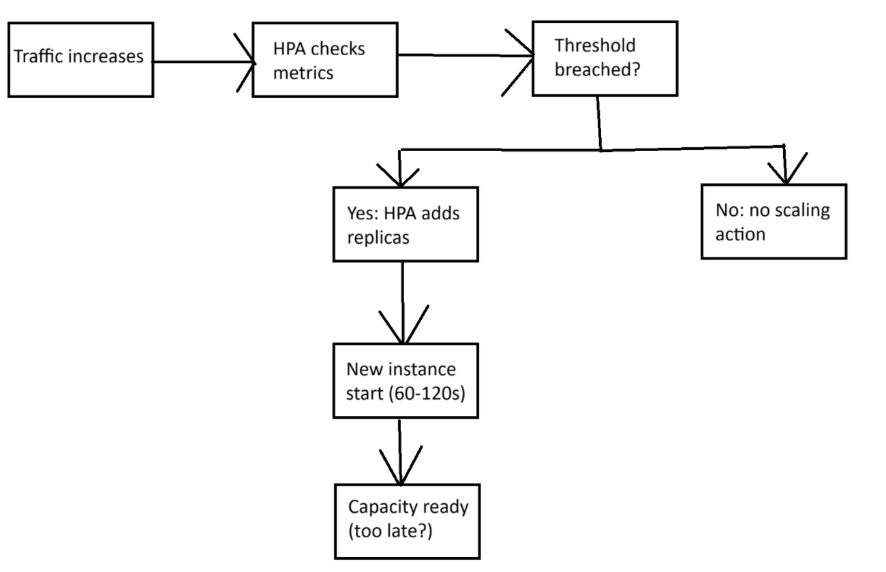

# Autoscaling for Resource Usage (CPU and memory)

**Author:** Shi Cheng Huang  
**Course:** CSC 59866  
**Selected project and option:** Build or improve a distributed system tool (option 1) - a predictive autoscaling for Kubernetes on resource usage to improve existing HPA before threshold is breached.     
**Current assignment:** 1  
**Friday commit deadline:** November 6 at 11:59 p.m. New York time  
**Monday presentation:** November 9 at 6:30 p.m. New York time  
**Last updated:** 11/6/26  
**Document status:** ready for review

## Progress note

<!-- Write 100–150 words: changes, learning, main open issue, feedback addressed,
and next step. Link evidence when available. Update at each Friday deliverable. -->
The problem research and scope understanding section is complete. The core problem of reactive autoscaling for resource lag, affected stakeholders (both internal and external), current workflow, documented evidence, six-week prototype contribution, Semester II scope, and exclusions for the project are defined. A workflow diagram of the reactive method (HPA) and a stakeholder table with working source links that support the claims of the responsibility/need for the stakeholders are integrated in Section 1. The primary open question is whether the prediction interval reduces SLO violations enough, at an acceptable resource cost, to justify its added complexity (located in Section 12). The next step is Requirements and Possible Solutions.

## Contents

- [1 Problem research and scope](#1-problem-research-and-scope)
- [2 Requirements and system specification](#2-requirements-and-system-specification)
- [3 Alternatives and selected solution](#3-alternatives-and-selected-solution)
- [4 Architectural design](#4-architectural-design)
- [5 Component design and interfaces](#5-component-design-and-interfaces)
- [6 Data structure design](#6-data-structure-design)
- [7 Algorithm design and execution](#7-algorithm-design-and-execution)
- [8 Failures and security](#8-failures-and-security)
- [9 Implementation and feasibility](#9-implementation-and-feasibility)
- [10 Testing and verification](#10-testing-and-verification)
- [11 Operation maintenance and future work](#11-operation-maintenance-and-future-work)
- [12 Revision history and references](#12-revision-history-and-references)

## 1 Problem research and scope

<!-- Assignment 1. Describe a person, task, difficulty, and consequence using
a concrete scenario. Label assumptions. Distinguish a larger research project's
aims from your own contribution where relevant. -->

**Problem and affected people:** The problem that I am investigating is the reactive autoscaling for resource usage, which means giving computer resources including CPU (central processing unit that processes instructions), memory (which stores active data) only after a threshold is crossed while working on a workload. As a reactive method, the system watches resource usage and only adds resources when CPU or memory crosses a threshold. This is inefficient when many different workloads must be managed, which leads to consequences such as slowing down the process and performance degradation within distributed computing systems.  
### The affected people are:
| Stakeholders | Type | Responsibility/Need | Source link |
|:---|:---|:---|:---|
| Cloud operators, platform engineers, and the organization | Internal | Responsible for the cluster and for allocating resources to avoid SLO violations | https://trepo.tuni.fi/handle/10024/238698#1 |
| Users and clients | External | Access the service and need fast responses without degradation | https://www.jisem-journal.com/index.php/journal/article/view/13473/6334 |

Where SLO is a target for service performance and a violation occurs when performance fails to meet that target within a given time window.

This problem matters because it costs money and hurts users' experience when workloads receive the wrong amount of resources. The problem occurs under conditions where resource demand changes so quickly that the system is unable to react, especially with unpredictable workloads. When demand for a workload is steady, the reactive method can function properly, but this is not always the case when demand is bursty.

**Current workflow:** To understand why this problem matters, consider a concrete example. A web service normally receives 100 requests per second. At a certain time, the traffic to the web service jumps to 500 requests per second within 30 seconds. The Horizontal Pod Autoscaler (HPA), a Kubernetes (a system for automating deployment and scaling of containerized applications) component that automatically adds or removes application instances when resource usage rises above or falls below a target threshold, checks metrics every 15–30 seconds. Thirty seconds later, it detects CPU above 80%, and 15 seconds after that, it starts scaling. Each new instance takes 60–120 seconds to start, after which new capacity is available. During the waiting period, existing instances are overloaded and lack resources. Response times increase, and some requests time out. 

     
Figure 1. The HPA control loop checks metrics every 15–30 seconds and adds replicas when the threshold is breached.

### Conditions and difficulty:
- Under normal conditions, reactive autoscaling works when resources are sufficient. 
- It fails when resources are insufficient (under-provisioning), causing slowdowns and timeouts.
- It wastes money when resources are excessive (over-provisioning), even though the service itself continues to function. 

Therefore, the right number of resources is required for service-level objective. 

**Evidence:** Reactive autoscaling is structurally lagging, with a three-to-five-minute timing period spent waiting to scale resources after the threshold is breached. During this window, it leads to tail-latency degradation (the slowest performance) and service-level objective (SLO) violations. [Documented] This claim is documented by the thesis of Tran, Duy Anh. 

**Six-week contribution:** By the end of six weeks, I will demonstrate the prototype with its architecture: 
- The system design on how the Random Forest forecasters with the two decision policies (point prediction and prediction interval), with simulator connects.
- A working prototype that can run on a small subset of the Alibaba 2021 trace.
- Initial forecast output to show that the pipeline functions.

**Semester II scope:** In semester II, I will add to the complete project with 
- full implementation using codes
- running simulations to test two designs policies (point prediction and prediction interval)
- measure the data on the count of SLO violations and additional resources allocated for each design.   

**Exclusions:** I will not build a production-ready system, modify the Kubernetes control plane, address GPU scheduling, train deep learning models, or consider I/O.

<!-- Add an actual image using a relative path, for example:


Figure 1. Explain what the workflow shows and why it matters.
Do not leave references to nonexistent images. -->

## 2 Requirements and system specification

<!-- Assignment 2. Explain required behavior before implementation methods.
Start with 3–5 functions, a correctness rule, and a quality target.
Complete design and test references during Assignments 2 and 3. -->
Work to come; they are not due yet.

| ID | Required behavior and conditions | Acceptance check | Design and test reference |
|---|---|---|---|
| F1 | User-visible capability | Concrete check | Add as design develops |
| C1 | Rule that must remain true | A case that could violate it | Add as design develops |
| Q1 | Measure, unit, target, workload | Measurement procedure | Mark as target until measured |

**Inputs and outputs:** Give an ordinary example and an unsuccessful example.

**Assumptions:** Conditions you rely on and how to check them.

**Constraints:** Limits on time, tools, data, and resources.

## 3 Alternatives and selected solution

<!-- Draft in Assignment 2; complete in Assignment 3. Compare at least two
approaches under the same requirements, including a simple baseline. -->
Work to come; they are not due yet.

| Approach and source | Useful behavior | Limitation | Evidence or assumption |
|---|---|---|---|
| Simple baseline | Replace | Replace | Replace |
| Candidate alternative | Replace | Replace | Replace |

**Choice and reason:** Connect your choice to requirements and constraints.

### Decision 1

**Context and requirement:** Why is a choice needed?  
**Options:** Plausible alternatives.  
**Decision and reason:** What you selected and why.  
**Consequences:** Benefits, costs, and limitations.  
**Status and revisit condition:** Proposed or accepted; what might change it?

### Decision 2

**Context and requirement:** Replace.  
**Options:** Replace.  
**Decision and reason:** Replace.  
**Consequences:** Replace.  
**Status and revisit condition:** Replace.

## 4 Architectural design

<!-- Assignment 3. Show context and the main running programs and stores.
Embed a diagram from assets and retain editable source. Mermaid is optional. -->
Work to come; they are not due yet.

**Boundary and outside participants:** Replace.

**Main parts and messages:** Explain responsibilities and labeled arrows.

**Where parts run:** Identify shared machines and dependencies.

**What I build reuse or simulate:** Replace.

## 5 Component design and interfaces

<!-- Assignment 3. A component can be a function or module in one program. -->
Work to come; they are not due yet.

| Component | Responsibility | Input | Output or state change |
|---|---|---|---|
| Replace | Replace | Replace | Replace |

**Critical operation:** Name and purpose.

**Input:** Fields, types, allowed values, caller identity, and example.

**Output:** Fields, meanings, and example.

**Errors:** Conditions and appropriate caller actions.

**Repeated or overlapping calls:** Define the behavior.

## 6 Data structure design
Work to come; they are not due yet.

<!-- Assignment 4. Explain information and meaning, not only storage syntax. -->

| Record or structure | Fields and example values | Relationships and rules | Persistence |
|---|---|---|---|
| Replace | Replace | Replace | What survives restart? |

**Ownership:** Identify the authoritative place for important facts.

**Invalid combinations:** Explain how they are prevented or detected.

**Retention and deletion:** Explain how long data is needed and what deletion changes.

## 7 Algorithm design and execution
Work to come; they are not due yet.

<!-- Assignment 4. Replace this block with your pseudocode. Explain any step
that hides a guarantee, such as a protected write. -->

```text
ALGORITHM NAME(inputs)
    replace with input checks
    replace with decisions and state changes
    replace with output and error behavior
```

**Normal sequence:** Numbered steps or an explained sequence diagram.

**Interrupted sequence:** Failure point, surviving state, and recovery.

**Overlapping activity:** A conflicting execution and the mechanism that handles it.

**Resource estimate:** A small justified estimate if it affects the choice.

## 8 Failures and security
Work to come; they are not due yet.

<!-- Assignment 4. Include three adverse scenarios and two misuse cases. -->

| Scenario | State that may survive | Expected behavior | Planned check |
|---|---|---|---|
| Replace | Replace | Replace | Replace |

**Selected adverse case for the prototype:** Name the case and why it matters.

**Excluded conditions and consequences:** Replace.

| Possible misuse and affected asset | Response | Remaining limitation and check |
|---|---|---|
| Replace | Replace | Replace |

## 9 Implementation and feasibility
Work to come; they are not due yet.

<!-- Begin the feasibility experiment and path in Assignment 3; refine in Assignment 4;
report implementation status in Assignments 5–6. -->

**Minimal path:** The smallest useful end-to-end operation.

**Feasibility experiment:** Question, procedure, evidence, finding, design consequence.

**Current implementation:** Distinguish implemented, reused, simulated, blocked, and deferred.

**Run instructions and CI:** Link README.md and the recorded check.

## 10 Testing and verification
Work to come; they are not due yet.

<!-- Plan in Assignment 4; add observations in Assignments 5–6. Expected outcomes
are not results. Link raw evidence. -->

| Test and requirement | Setup and procedure | Expected result | Status and evidence |
|---|---|---|---|
| T1 normal operation | Replace | Replace | Planned until run |
| T2 correctness rule | Replace | Replace | Planned until run |
| T3 adverse scenario | Replace | Replace | Planned until run |

**Baseline and comparison question:** Replace.

**Workload and environment:** Inputs, counts, timing, overlap, versions, machine, and reset.

**Measurements:** Units and populations, including unsuccessful operations.

**Actual results:** Explain what happened and what the evidence supports.

**Limits and next test:** State remaining uncertainty.

## 11 Operation maintenance and future work
Work to come; they are not due yet.

<!-- Draft in Assignment 4; add operating instructions in Assignment 5;
complete in Assignment 6. -->

**Startup and diagnosis:** How to run the system and recognize a problem.

**Recovery:** Action, preserved state, and verification of recovery.

**One future change:** Effects on components, interfaces, data, and tests.

**Update and rollback:** How to change versions and recover a working configuration.

**Responsible design:** Connect people, data, access, reuse, and resource use to choices.

| Risk | Early sign | Response or fallback |
|---|---|---|
| Replace | Replace | Replace |

| Semester II milestone | Dependency | Completion evidence | Essential or optional |
|---|---|---|---|
| Replace | Replace | Replace | Replace |

## 12 Revision history and references

| Revision date | Change to my design | Reason and evidence |
|---|---|---|
| Replace | Replace | Replace |

| Open question | Why it matters | Next action |
|---|---|---|
| Will the prediction interval reduce SLO violations enough, at an acceptable resource cost, to justify its added complexity? This remains to be tested. | It determines whether the interval policy is used in the final design | Run the simulation on the Alibaba 2021 trace and compare SLO violation rates with additional resource used|

**Assistance and reuse:** Attribute sources, code, data, diagrams, and assistance under course policy.

### References

<!-- Use descriptive links with author/organization, title, date/version, and
the claim supported. Also cite sources near relevant explanations. -->
Tran, Duy Anh. "Predictive autoscaling for kubernetes using machine learning workload forecasting", Tampere University, June 2026, https://trepo.tuni.fi/handle/10024/238698#1

### Supporting media and evidence

<!-- Link actual images, editable diagram files, logs, data, and optional video.
Explain each item's purpose. Avoid missing files and private-only paths. -->
- Figure 1 (Section 1): workflow diagram of the HPA control loop. The image is stored at `assets/workflow.png` and shows how HPA checks metrics every 15–30 seconds, detects a threshold breach, and adds replicas that take 60–120 seconds to start. This illustrates the three-to-five-minute lag that the project addresses.

### Final document check

- [ ] Terms and examples make the project understandable to a beginner.
- [ ] All twelve sections contain project-specific content.
- [ ] Requirements connect to design and tests.
- [ ] Architecture, components, data, and algorithms agree.
- [ ] Targets and plans are separate from observations.
- [ ] Tables, images, pseudocode, references, and evidence links render correctly.
- [ ] Images have alternative text, captions, and readable labels.
- [ ] Run instructions and evidence support reproduction.
- [ ] I am prepared to present my work and orally review the same selected group mate.
- [ ] Remaining work and maintenance needs are explicit.
- [ ] Instructional placeholders are removed from the final submission.